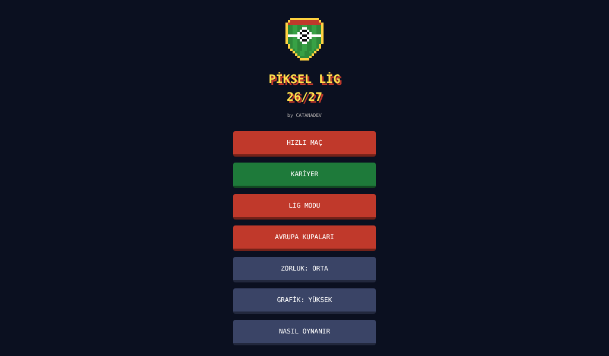
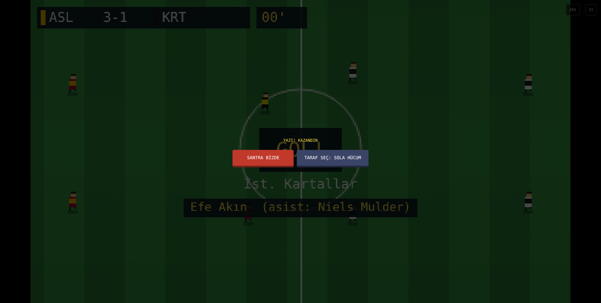

<h1 align="center">Piksel Lig 26/27</h1>

<b>by CATANADEV</b> · Tarayıcıda oynanan 11'e 11 piksel futbol oyunu · Kurulum yok, tek HTML dosyası

<a href="https://furher92.github.io/pixel-lig/"><b>▶ HEMEN OYNA</b></a>

 

## Özellikler
- **11'e 11 maç motoru:** faul, frikik ve baraj, penaltı, kart, VAR, hakem, uzatmalar, yazı tura, devrede taraf değişimi
- **10 lig, 229 takım:** 2026/27 sezonu (takım ve oyuncu adları kurgusal, lisanssız)
- **Menajer kariyeri:** menajer oluştur, transfer ve kiralık, yönetim güveni, yerel kupa, süper kupa (TFF 4'lü final dahil), Şampiyonlar / Avrupa / Konferans Ligi (ön elemeler dahil), Avrupa Süper Kupası, milli takım teklifleri (UEFA, Asya, Güney Amerika) ve EURO / Dünya Kupası / Asya Kupası / Copa América
- **Oyuncu kariyeri:** 17 yaşında başla, sadece kendi oyuncunu yönet, gelişim, transfer teklifleri, milli takım çağrısı, ödüller (gol kralı, Altın Top)
- **Avrupa kupaları modu:** gerçek 26/27 kura ve fikstür
- **Zorluk:** Amatör / Orta / Pro / Efsane · **Grafik:** Düşük / Orta / Yüksek
- **Ses:** menü müziği, tribün, tezahürat

## Kontroller
| Tuş | Görev |
|---|---|
| Ok tuşları | Koş |
| X | Pas (topsuzken basılı tut = pres) |
| W | Ara pas |
| D | Orta (topsuzken kayarak müdahale) |
| A | Şut (basılı tut, POWER bölgesi = power shot) |
| E | Depar |
| Q | Oyuncu değiştir |
| P | Duraklat |
| M | Ses aç/kapa |

## Hangi sürüm?
| Sürüm | Dosya | Nerede? |
|---|---|---|
| **Orijinal** | `index.html` | Windows 10/11, Linux, macOS; Chrome / Edge / Firefox |
| **Legacy** | `PikselLig_Legacy.html` | Eski PC'ler: Windows 7 / Vista / ReactOS ve Atom + 1 GB RAM sınıfı (LG X130 gibi) |

Legacy sürümü `PikselLig_Legacy_Baslat.bat` ile aç. Bu dosya Supermium'u hafif ayarlarla başlatır: GPU kapalı, ayrı profil, otomatik ses. Internet Explorer ile çalışmaz. Windows ME desteklenmez.

## Yasal not
Bu oyun lisanssızdır. Takım, oyuncu ve kupa adları kurgusaldır; gerçek kulüp, kişi veya organizasyonlarla resmi bir bağı yoktur. Milli takımlar ülke adlarıyla yer alır, oyuncuları kurgusaldır.

---

## English
**Piksel Lig 26/27** is an 11-a-side pixel football game that runs in the browser as a single HTML file. It has a manager career (domestic cups, super cups, European competitions, national team jobs), a player career, and a European cups mode with real 26/27 draws. Team and player names are fictional (unlicensed). Use `index.html` on modern PCs and the `PikselLig_Legacy.html` build on old Windows 7 / Vista / ReactOS machines.

© 2026 Catanadev — Furkan Çatanaoğlu
